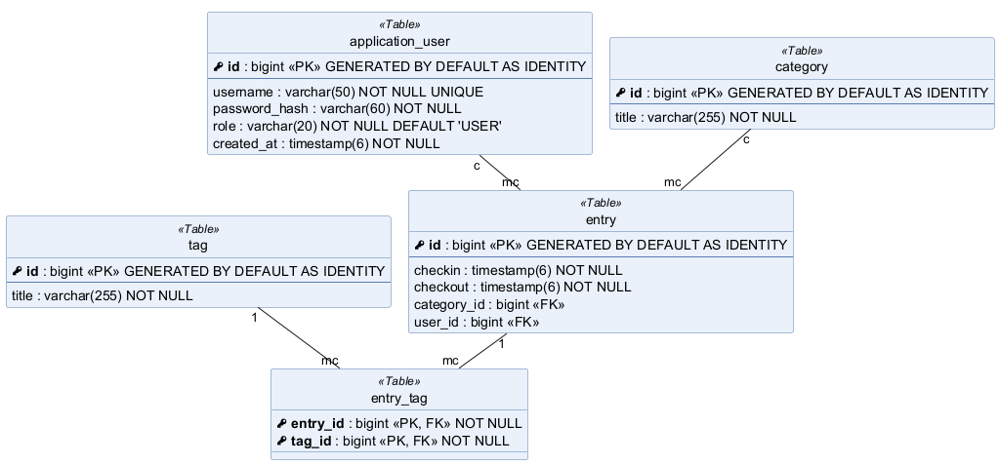
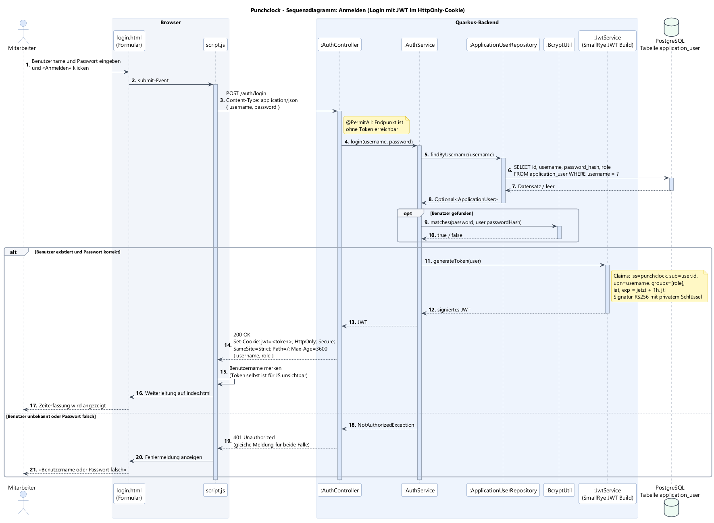
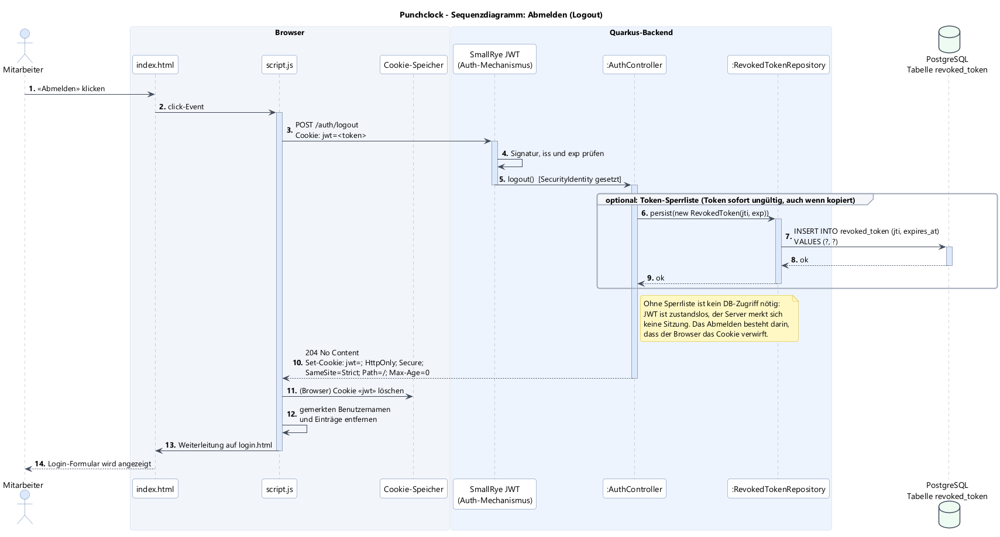
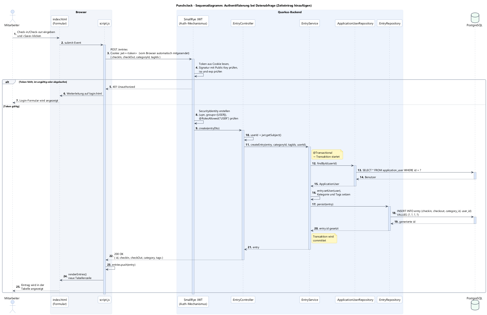

# Planung: JWT-Authentifizierung für Punch Clock

## 1. Datenmodell



### Neue Entität `ApplicationUser` (Tabelle `application_user`)

`User` ist u. a. in PostgreSQL und H2 ein reserviertes Wort, deshalb heisst die Entität `ApplicationUser`.

| Attribut        | Typ            | Constraints                  | Begründung |
|-----------------|----------------|------------------------------|------------|
| `id`            | `bigint`       | PK, Identity                 | Wie bei allen anderen Entitäten. Wird als `sub`-Claim ins JWT geschrieben. |
| `username`      | `varchar(50)`  | NOT NULL, UNIQUE             | Login-Name. Muss eindeutig sein, damit `findByUsername` genau einen Benutzer liefert. |
| `password_hash` | `varchar(60)`  | NOT NULL                     | **Nie das Klartext-Passwort speichern.** BCrypt-Hashes sind immer 60 Zeichen lang und enthalten Salt und Kostenfaktor. |
| `role`          | `varchar(20)`  | NOT NULL, Default `'USER'`   | Rolle für die Autorisierung (`USER`, `ADMIN`). Landet im `groups`-Claim und wird mit `@RolesAllowed` geprüft. |
| `created_at`    | `timestamp(6)` | NOT NULL                     | Nachvollziehbarkeit, wann das Konto erstellt wurde. |

### Relationen

- **`application_user` c : mc `entry`** (neue Spalte `entry.user_id`, FK, nullable):
  Ein Zeiteintrag wird von einem Mitarbeiter erstellt, ein Mitarbeiter kann beliebig viele Einträge haben. Laut Auftrag wird der Benutzer nur zugeordnet, wenn ein `Authorization`-Header mitgeschickt wird. Einträge ohne Token bleiben darum vorerst ohne Benutzer erlaubt. Sobald alle Endpunkte geschützt sind, kann die Spalte auf NOT NULL gesetzt werden.
- **`category` und `tag` bekommen keine Referenz auf den Benutzer.** Kategorien (z. B. «Projektarbeit», «Schule») und Tags sind für alle Mitarbeiter gleich und werden gemeinsam genutzt. Eine Zuordnung zu einem Benutzer würde zu doppelten Kategorien führen. Das Verwalten davon kann später auf die Rolle `ADMIN` beschränkt werden.

JPA-Abbildung in `Entry`:

```java
@ManyToOne
@JoinColumn(name = "user_id")
private ApplicationUser user;
```

## 2. JWT kurz erklärt

Ein JSON Web Token besteht aus drei Base64URL-codierten Teilen, getrennt durch Punkte: `header.payload.signature`.

- **Header**: Algorithmus und Typ, z. B. `{"alg":"RS256","typ":"JWT"}`
- **Payload (Claims)**: `iss` (Aussteller), `sub` (Benutzer-ID), `upn` (Benutzername), `groups` (Rollen), `iat`/`exp` (ausgestellt/läuft ab), `jti` (eindeutige Token-ID)
- **Signature**: Signatur über Header und Payload mit dem privaten Schlüssel des Servers

Der Payload ist **nur codiert, nicht verschlüsselt**, also gehören keine Geheimnisse hinein. Die Signatur stellt sicher, dass niemand den Inhalt verändert hat. Weil der Server beim Prüfen nur den öffentlichen Schlüssel braucht, muss er sich **keine Sitzung merken** (zustandslos). Bei einem Request ist für die Authentifizierung also kein DB-Zugriff nötig.

## 3. Gewählter Ansatz: JWT im HttpOnly-Cookie

> **Stand der Umsetzung:** In der ersten Version wird das Token laut Auftrag als `Authorization: Bearer <token>`-Header geschickt (`mp.jwt.token.header=Authorization`). So lässt es sich einfach mit Swagger und `docs/testdaten.http` testen. Der Wechsel auf das Cookie ist der nächste Schritt (`mp.jwt.token.header=Cookie`, `mp.jwt.token.cookie=jwt`).

| Variante | Vorteil | Nachteil |
|----------|---------|----------|
| JWT im `localStorage` + `Authorization: Bearer`-Header | Einfach, kein CSRF | Mit XSS kann jedes Skript das Token lesen und stehlen |
| **JWT im `HttpOnly`-Cookie** ✅ | JavaScript kann das Token nicht lesen, Browser sendet es automatisch mit | CSRF muss verhindert werden → mit `SameSite=Strict` gelöst |

Cookie-Attribute: `HttpOnly; Secure; SameSite=Strict; Path=/; Max-Age=3600`

**Abmelden:** Da das JWT zustandslos ist, kann der Server es nicht «löschen». Der Server überschreibt das Cookie mit `Max-Age=0`, damit der Browser es verwirft. Optional kann die `jti` in einer Sperrliste (`revoked_token`) gespeichert werden, damit auch ein kopiertes Token sofort ungültig ist. Für dieses Projekt reicht eine kurze Gültigkeit (1 h) ohne Sperrliste. Die Sperrliste ist darum nicht im ERD.

## 4. Sequenzdiagramme

### Anmelden


### Abmelden


### Authentifizierung bei einer Datenabfrage (Zeiteintrag hinzufügen)


## 5. Umsetzungsschritte (Quarkus)

1. **Abhängigkeiten** in `pom.xml`: `quarkus-smallrye-jwt` (Prüfen), `quarkus-smallrye-jwt-build` (Erstellen), `quarkus-elytron-security-common` (`BcryptUtil`).
2. **Schlüsselpaar** erzeugen (`privateKey.pem`, `publicKey.pem`). Der private Schlüssel kommt nicht ins Git.
3. **Konfiguration** in `application.properties`:
   ```properties
   mp.jwt.verify.publickey.location=publicKey.pem
   mp.jwt.verify.issuer=punchclock
   mp.jwt.token.header=Cookie
   mp.jwt.token.cookie=jwt
   smallrye.jwt.sign.key.location=privateKey.pem
   ```
4. **Modell**: `ApplicationUser` und `ApplicationUserRepository` (`findByUsername`) erstellen, `Entry.user` ergänzen.
5. **`AuthController`** mit `POST /auth/login` (`@PermitAll`) und `POST /auth/logout` (`@Authenticated`), dazu `AuthService` und `LoginRequestDto`.
6. **Endpunkte schützen**: `EntryController`, `CategoryController`, `TagController` mit `@RolesAllowed("USER")` (bzw. `ADMIN` für Kategorien und Tags verwalten).
7. **Datenzugriff einschränken**: `EntryService` filtert alle Abfragen nach `user_id` aus dem Token. Bei fremden Einträgen gibt `PUT`/`DELETE` `404` zurück.
8. **Frontend**: `login.html` mit Formular, `script.js` reagiert auf `401` mit Weiterleitung zum Login, Logout-Button.
9. **Testdaten**: Beispielbenutzer mit BCrypt-Hash in `import.sql`, Tests mit `@TestSecurity(user = "...", roles = "USER")` ergänzen.
